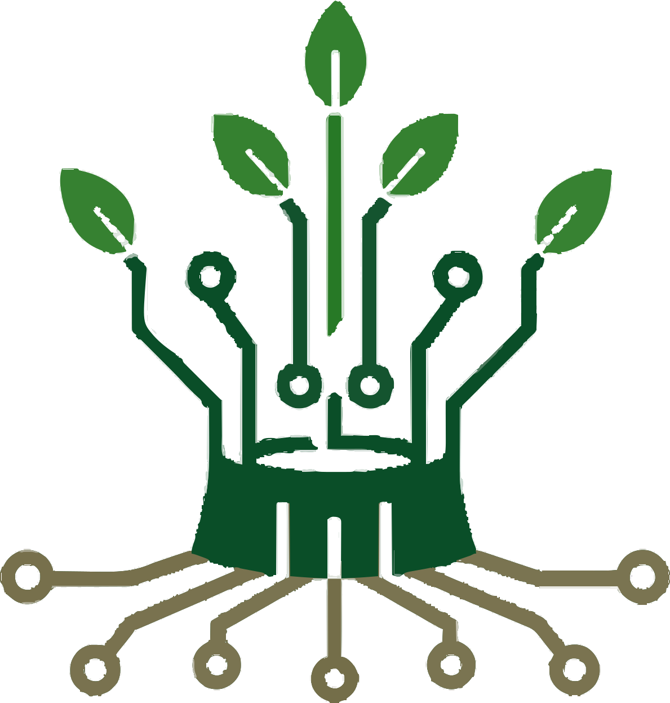
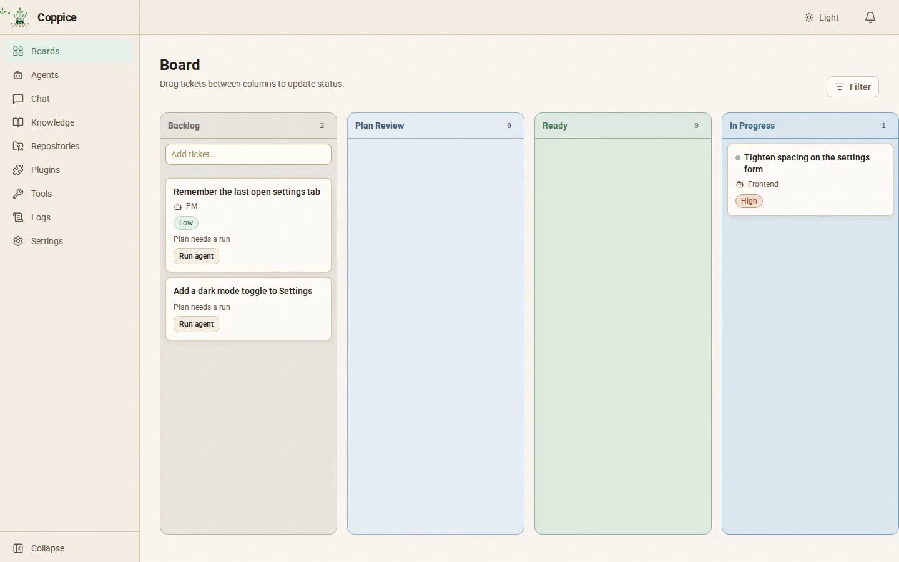
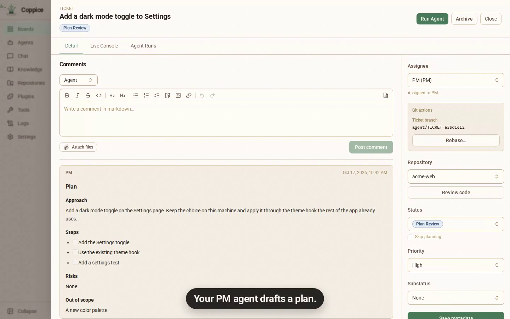
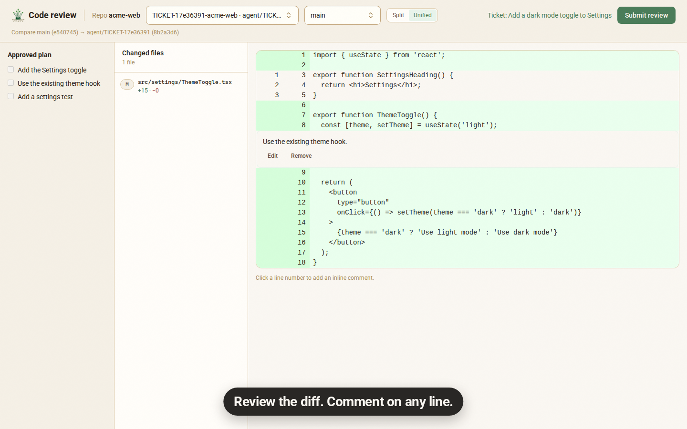

[English](README.md) · [简体中文](README.zh-CN.md) · [繁體中文（台灣）](README.zh-TW.md) · [繁體中文（香港）](README.zh-HK.md) · [日本語](README.ja.md) · [Français](README.fr.md)

  

<h1 align="center">Coppice</h1>

  <strong>Recrutez des spécialistes. Gardez le dernier mot.</strong> 
  Des agents de code, chacun avec son rôle, planifient, construisent et relisent sur un seul tableau, et rien n’est terminé tant que vous n’avez pas accepté le diff. 
  Local, open source, avec les CLI d’agents que vous payez déjà.

  <a href="https://github.com/fertile-org/coppice/releases/latest/download/Coppice-mac-arm64.dmg"><strong>Télécharger pour macOS (Apple Silicon)</strong></a> ·
  <a href="https://github.com/fertile-org/coppice/releases/latest/download/Coppice-linux-amd64.deb"><strong>Télécharger pour Linux (.deb)</strong></a> ·
  <a href="https://getcoppice.app/fr/download">Autres téléchargements</a> ·
  <a href="https://getcoppice.app/fr/docs">Documentation</a>

  
  
  

  

Votre agent PM rédige le plan, et vous l’approuvez. Des agents spécialisés construisent en parallèle, chacun sur sa branche. Le tableau montre ce qui avance, ce qui bloque et ce qui vous attend. Rien n’est terminé tant que vous n’avez pas accepté le diff.

Téléchargez, ouvrez, travaillez. Rien à installer : pas de Docker, pas de compte Coppice.

## Pourquoi Coppice

- **Le bon modèle pour chaque rôle.** Chaque agent choisit sa CLI et son modèle. Planifiez et relisez avec votre modèle le plus fort, codez avec un plus rapide, le tout sur un seul tableau.
- **Arrêtez de jongler entre les terminaux.** Le travail de chaque agent est une carte sur un seul tableau. Les tickets bloqués et le travail qui attend votre revue ressortent, donc vous savez où on a besoin de vous.
- **Repérez les erreurs avant qu’elles n’arrivent.** Chaque changement vous attend sous forme de diff dans l’application. Rien ne compte comme terminé tant que vous ne l’avez pas accepté, et ce que vous acceptez est exactement ce qui est fusionné.
- **Pas de deuxième abonnement.** Coppice pilote les CLI que vous payez déjà, connectées comme vous en avez l’habitude.

## Comment ça marche

1. **Confiez le travail.** Écrivez un ticket, ou approuvez celui qu’un agent propose. Assignez-le à votre agent PM, qui rédige un plan que vous approuvez avant que quiconque n’écrive du code. Activez **Skip planning** (sauter la planification) pour envoyer un ticket directement en Ready.
2. **Laissez les agents construire.** Chaque ticket a son propre worktree git, donc les agents qui travaillent en parallèle ne touchent jamais à votre checkout principal. Suivez n’importe quel lancement en direct.
3. **Human Review.** Lisez le diff dans l’application et commentez n’importe quelle ligne. Rien ne compte comme terminé tant que vous ne l’avez pas accepté.

<table>
  <tr>
    <td width="33%"></td>
    <td width="33%"></td>
    <td width="33%"></td>
  </tr>
  <tr>
    <td align="center">Un tableau pour tous les agents</td>
    <td align="center">Approuvez d’abord le plan</td>
    <td align="center">Relisez le diff, ligne par ligne</td>
  </tr>
</table>

## Avec les CLI que vous utilisez déjà

Installez-les et connectez-vous comme d’habitude. Coppice les trouve dans le `PATH` de votre shell de connexion.

| CLI | Commande |
| --- | --- |
| Claude Code | `claude` |
| Codex | `codex` |
| Cursor | `cursor-agent` |
| OpenCode | `opencode` |
| Kilo Code | `kilo` |
| GitHub Copilot | `copilot` |
| Qwen Code | `qwen` |
| Kimi Code | `kimi` |
| Grok | `grok` |

Voir [Fournisseurs](https://getcoppice.app/fr/docs/providers) pour les liens d’installation et ce que chacune prend en charge.

## Et aussi

- **Discutez avec vos agents.** Parlez de votre code, d’une idée ou d’un ticket. Un agent peut rédiger un ticket ou proposer une note de Knowledge, mais rien n’est enregistré tant que vous ne l’avez pas approuvé.
- **Tout est sur la carte.** Les commentaires, les plans et les lancements d’agents vivent sur le ticket. Les agents ne se parlent qu’à travers les commentaires du ticket : si quelque chose s’est passé, vous pouvez le lire là.
- **Knowledge.** Les agents enregistrent des notes sur votre projet pour les tickets suivants. Par défaut, c’est vous qui approuvez ce qu’ils gardent.
- **Plugins.** Donnez aux agents des skills et des outils MCP. Installez un plugin depuis git ou un dossier, puis choisissez quels agents peuvent l’utiliser.
- **Mises à jour automatiques.** L’application Linux se met à jour via apt, et l’application macOS se met à jour toute seule.

## Ce que ce n’est pas

- Pas un service de code dans le cloud
- Pas un remplaçant de Jira
- Pas « dites-le à l’agent et recevez le produit fini »

## Pour commencer

1. [Téléchargez Coppice](https://getcoppice.app/fr/download) : un `.dmg` pour macOS (Apple Silicon ou Intel), un `.deb` pour Linux (`amd64` ou `arm64`), ou Windows 11 via WSL.
2. Suivez les [étapes d’installation](https://getcoppice.app/fr/docs/install).
3. Lisez [Bien démarrer](https://getcoppice.app/fr/docs/getting-started) pour configurer votre premier agent et votre premier ticket.

**Beta.** Coppice est en beta. [Ouvrez une issue](https://github.com/fertile-org/coppice/issues) quand quelque chose casse ou semble bizarre.

## Contributeurs

Les contributeurs et la CI lancent la stack avec Docker Compose. Commencez par [AGENTS.md](AGENTS.md) et [docs/development.md](docs/development.md). La feuille de route est dans [docs/milestones/README.md](docs/milestones/README.md). La documentation produit est le site dans [`website/`](website/).

## Licence

Coppice est open source sous [licence Apache 2.0](LICENSE).
