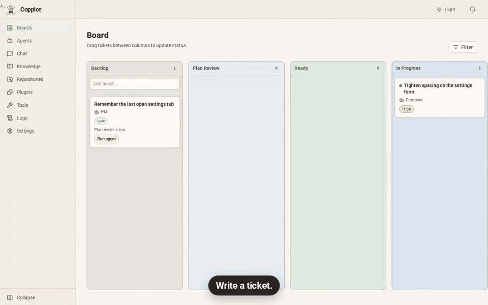

[English](README.md) · [简体中文](README.zh-CN.md) · [繁體中文（台灣）](README.zh-TW.md) · [繁體中文（香港）](README.zh-HK.md) · [日本語](README.ja.md) · [Français](README.fr.md)

# Coppice

**Beta.** Recrutez des spécialistes. Gardez le dernier mot.

  

**Arrêtez de jongler entre les terminaux d’agents.** Écrivez un ticket et votre agent PM rédige un plan que vous approuvez. Ensuite Claude Code, Codex et les autres construisent, relisent et testent en parallèle, chacun sur sa branche. Le tableau montre ce qui avance, ce qui bloque et ce qui vous attend, et rien ne compte comme terminé tant que vous n’avez pas relu le diff. Ça tourne sur votre machine avec les CLI d’agents que vous payez déjà : pas de nouvel abonnement, pas de compte Coppice.

## Les validations

Le travail s’arrête pour vous à deux endroits :

1. **Plan Review** (revue du plan). Votre agent PM rédige un plan, et vous l’approuvez ou demandez des changements avant que le travail commence. La planification ne modifie jamais le code du ticket. Activez Skip planning (sauter la planification) pour envoyer un ticket directement en Ready.
2. **Wait for Human Review** (en attente de revue humaine). Vous relisez le diff. Le ticket reste dans cette colonne jusqu’à ce que vous l’acceptiez.

C’est vous qui lancez le travail. Créez un ticket, ou approuvez celui qu’un agent a proposé. Les agents planifient et construisent entre ces deux validations.

## Cette beta

Les installeurs de la beta sont un `.dmg` pour macOS (Apple Silicon ou Intel) et un `.deb` pour Linux (`amd64` ou `arm64`). Récupérez-les sur la [page des versions](https://github.com/fertile-org/coppice/releases).

Apportez les CLI que vous utilisez déjà : Claude Code, Codex, Cursor, OpenCode, Kilo Code, GitHub Copilot, Qwen Code, Kimi Code et Grok. Installez-les et connectez-vous comme d’habitude. Coppice les trouve dans le `PATH` de votre shell de connexion.

## Pour commencer

La documentation produit est le site dans [`website/`](website/) : la page d’accueil et les guides d’utilisation. Le site public est [https://getcoppice.app/](https://getcoppice.app/).

## Contributeurs

Les contributeurs et la CI lancent la stack avec Docker Compose. Commencez par [AGENTS.md](AGENTS.md) et [docs/development.md](docs/development.md). La feuille de route est dans [docs/milestones/README.md](docs/milestones/README.md).

## Licence

Coppice est open source sous [licence Apache 2.0](LICENSE).
