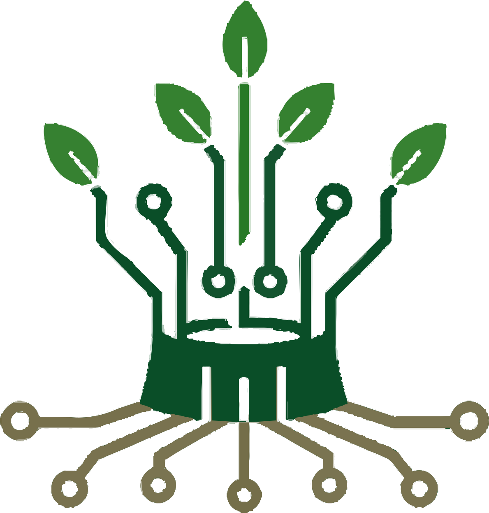
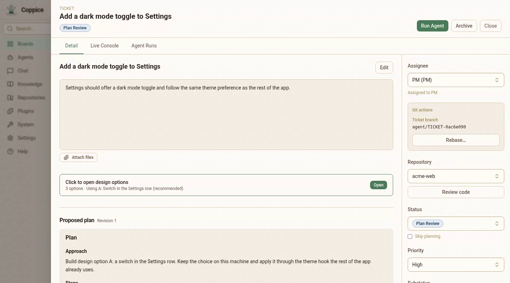
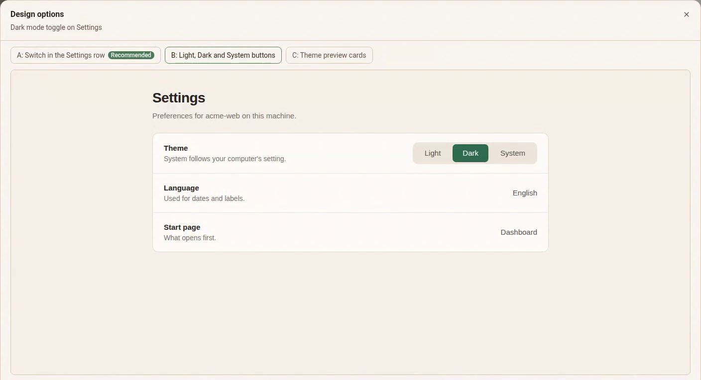
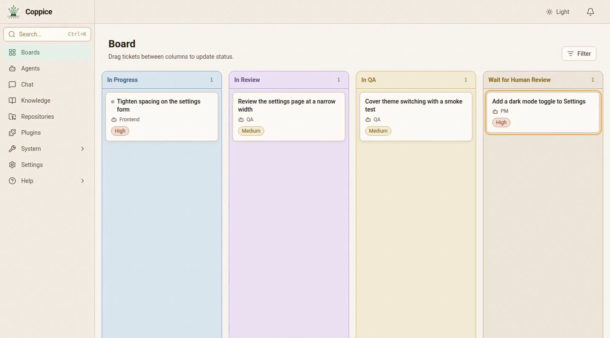
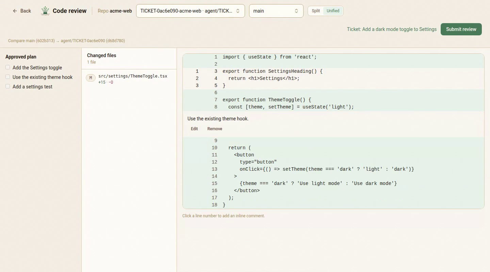

  <a href="README.md">English</a> ·
  <a href="README.vi.md">Tiếng Việt</a> ·
  <a href="README.zh-CN.md">简体中文</a> ·
  <a href="README.zh-TW.md">繁體中文（台灣）</a> ·
  <a href="README.zh-HK.md">繁體中文（香港）</a> ·
  <a href="README.ja.md">日本語</a> ·
  <a href="README.fr.md">Français</a>

  

<h1 align="center">Coppice</h1>

  <strong>専門家を雇い、最終判断はあなたに。</strong> 
  マルチエージェント開発のデスクトップアプリです。エージェントが 1 つのボードで計画し、作り、レビューします。あなたが diff を承認するまで、何も完了にはなりません。 
  ローカルで動くオープンソースです。すでに契約しているエージェント CLI をそのまま使います。

  <a href="https://github.com/fertile-org/coppice/releases/latest/download/Coppice-mac-arm64.dmg"><strong>macOS 版をダウンロード（Apple Silicon）</strong></a> ·
  <a href="https://github.com/fertile-org/coppice/releases/latest/download/Coppice-linux-amd64.deb"><strong>Linux 版をダウンロード（.deb）</strong></a> ·
  <a href="https://getcoppice.app/ja/download">そのほかのダウンロード</a> ·
  <a href="https://getcoppice.app/ja/docs">ドキュメント</a>

  
  
  

  

PM エージェントが計画を下書きし、あなたが承認します。専門のエージェントが、それぞれ自分のブランチで並行して作ります。ボードを見れば、進んでいる作業、止まっている作業、あなたを待っている作業が分かります。

ダウンロードして、開いて、作業するだけです。準備は要りません。Docker も Coppice アカウントも不要です。

## Coppice を選ぶ理由

- **役割ごとに、ふさわしいモデルを。** エージェントごとに CLI とモデルを選べます。計画とレビューにはいちばん強いモデルを、コーディングには速いモデルを使います。すべて 1 つのボードの上です。
- **ターミナルを行き来するのはもう終わり。** すべてのエージェントの作業が 1 つのボードのカードになります。ブロックされたチケットやレビュー待ちの作業が目立つので、どこで自分が必要かが分かります。
- **取り込まれる前にミスを見つける。** すべての変更は、アプリの中の diff としてあなたを待ちます。あなたが承認するまで何も完了にはならず、承認した内容がそのままマージされます。
- **2 つ目のサブスクリプションは不要。** Coppice は、あなたがすでに契約していて、いつもの方法でサインインしている CLI を動かします。対応している CLI は [プロバイダー](https://getcoppice.app/ja/docs/providers) を見てください。

## 使い方

### PM エージェントと計画する

PM エージェントがチケットを読み、方針、手順、変更の確認方法を計画に下書きします。コードを書き始める前に、あなたがその計画を承認します。

### デザインを承認する

チケットが画面の見た目を変えるとき、エージェントはいくつかのレイアウトを見せ、おすすめを示します。あなたが一つを選ぶと、計画はその選択に沿います。

### エージェントに作らせる

専門のエージェントがチケットを作り、レビューし、テストします。チケットごとに専用の git worktree があるので、並行作業はメインのチェックアウトに触れません。

### コードの変更をレビューする

アプリで diff を読み、どの行にもコメントできます。あなたが承認するまで何も完了にはならず、Accept と Merge は別の操作です。

## ほかにできること

- **エージェントとチャット。** コード、アイデア、チケットについて話せます。エージェントはチケットを下書きしたり Knowledge のメモを提案したりできますが、あなたが承認するまで何も保存されません。
- **すべてはカードの上に。** コメント、計画、エージェントの実行はチケットに残ります。エージェント同士はチケットのコメントだけでやり取りするので、起きたことはそこで読めます。
- **Knowledge。** エージェントは、あとのチケットのためにプロジェクトについてのメモを残します。既定では、残す内容はあなたが承認します。
- **プラグイン。** エージェントにスキルと MCP ツールを与えます。git かフォルダーからプラグインを入れて、使えるエージェントを選びます。
- **自動アップデート。** Linux 版は apt でアップデートし、macOS 版はアプリ自身がアップデートします。

## Coppice ではないもの

- クラウドのコーディングサービスではありません
- Jira の代わりではありません
- 「エージェントに伝えれば完成品が届く」ものではありません

## はじめに

1. [Coppice をダウンロード](https://getcoppice.app/ja/download)：macOS 用の `.dmg`（Apple Silicon または Intel）、Linux 用の `.deb`（`amd64` または `arm64`）、または WSL 経由の Windows 11。
2. [インストール手順](https://getcoppice.app/ja/docs/install) に従います。
3. [はじめに](https://getcoppice.app/ja/docs/getting-started) を読んで、最初のエージェントとチケットを用意します。

**Beta。** Coppice はベータ版です。壊れたところやおかしなところがあれば、[issue を開いて](https://github.com/fertile-org/coppice/issues)ください。

## コントリビューター

コントリビューターと CI は Docker Compose でスタックを動かします。まず [AGENTS.md](AGENTS.md) と [docs/development.md](docs/development.md) を読んでください。ロードマップは [docs/milestones/README.md](docs/milestones/README.md) です。製品ドキュメントは [`website/`](website/) のサイトです。

## ライセンス

Coppice は [Apache 2.0 ライセンス](LICENSE) のオープンソースです。
