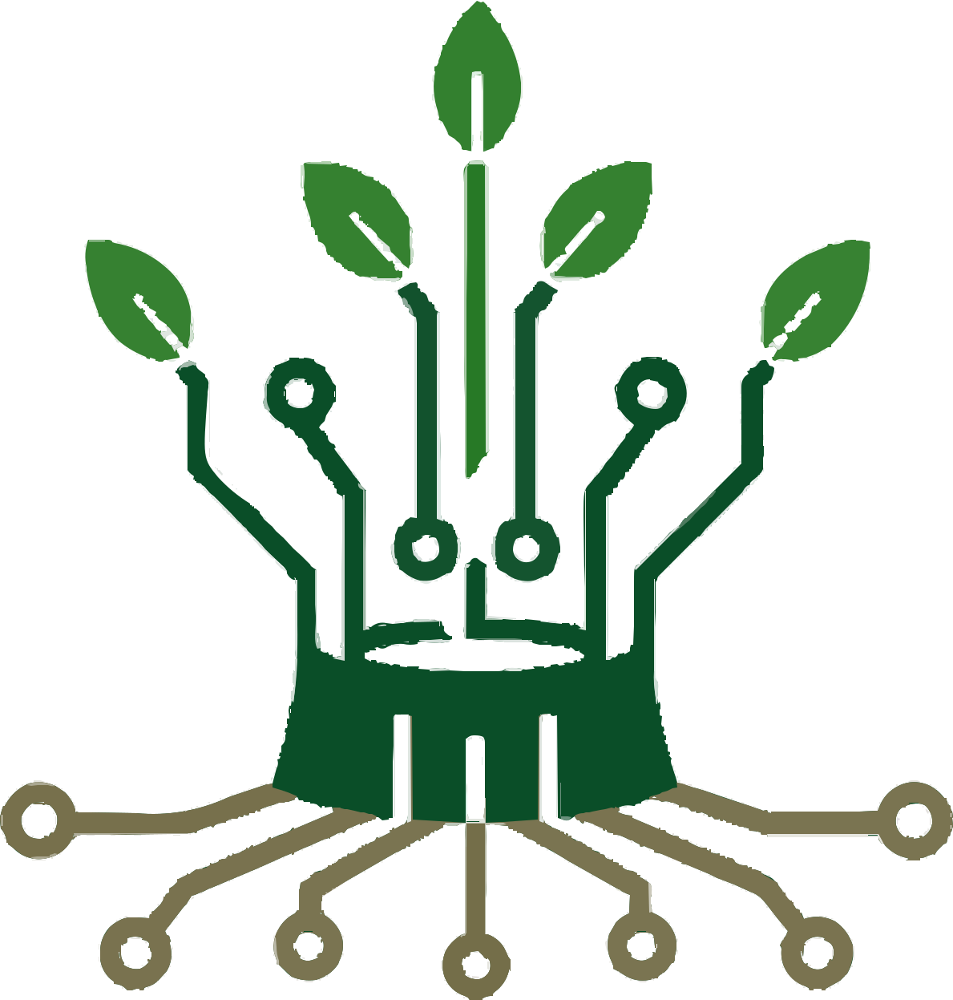
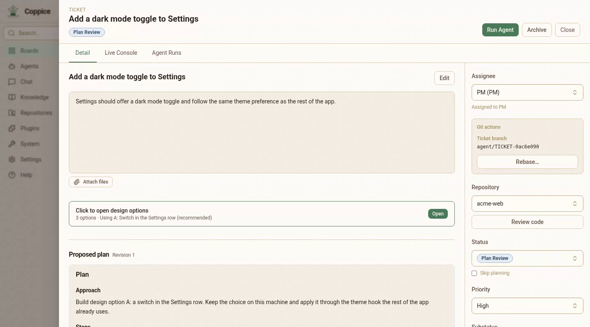
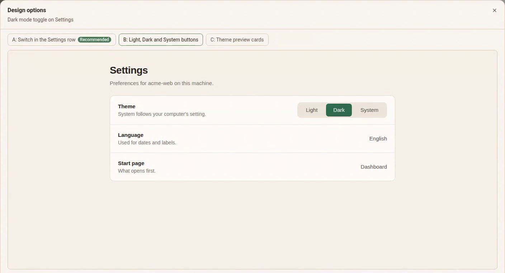
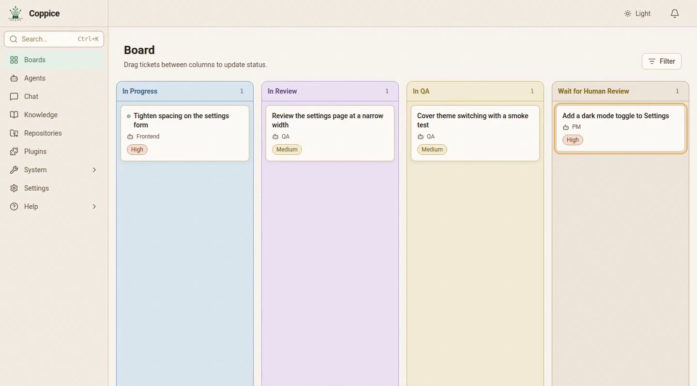
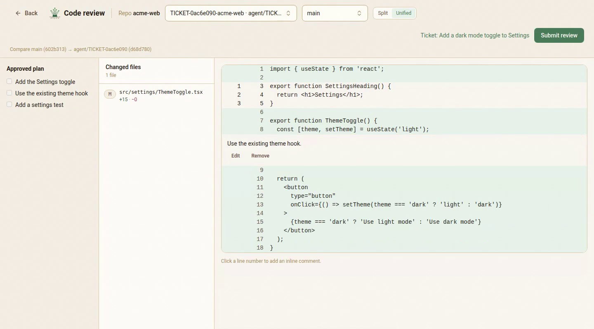

  <a href="README.md">English</a> ·
  <a href="README.vi.md">Tiếng Việt</a> ·
  <a href="README.zh-CN.md">简体中文</a> ·
  <a href="README.zh-TW.md">繁體中文（台灣）</a> ·
  <a href="README.zh-HK.md">繁體中文（香港）</a> ·
  <a href="README.ja.md">日本語</a> ·
  <a href="README.fr.md">Français</a>

  

<h1 align="center">Coppice</h1>

  <strong>Hire specialists. Keep the final say.</strong> 
  A desktop app for multi-agent coding. Agents plan, build, and review on one board. Nothing is done until you accept the diff. 
  It runs on your machine, it is open source, and it uses the agent CLIs you already pay for.

  <a href="https://github.com/fertile-org/coppice/releases/latest/download/Coppice-mac-arm64.dmg"><strong>Download for macOS (Apple Silicon)</strong></a> ·
  <a href="https://github.com/fertile-org/coppice/releases/latest/download/Coppice-linux-amd64.deb"><strong>Download for Linux (.deb)</strong></a> ·
  <a href="https://getcoppice.app/download">Other downloads</a> ·
  <a href="https://getcoppice.app/docs">Docs</a>

  
  
  

  

Your PM agent drafts the plan, and you approve it. Specialist agents build in parallel, each on its own branch. The board shows what's moving, what's stuck, and what's waiting on you.

Download the app and open it. There's nothing to set up: no Docker and no Coppice account.

## Why Coppice

- **The right model for each role.** Each agent uses its own CLI and model. You can plan and review with your strongest model, and code with a faster one, on the same board.
- **Stop tab-hopping between terminals.** Each agent's work is a card on one board. Blocked tickets, and work waiting for your review, stand out, so you can see where you're needed.
- **Catch mistakes before they land.** Every change waits for you as a diff in the app. Nothing counts as done until you accept it, and what you accept is exactly what merges.
- **No second subscription.** Coppice drives the CLIs you already pay for, using the sign-in you already use for each CLI. See the [supported CLIs](https://getcoppice.app/docs/providers).

## How it works

### Planning with the PM agent

Your PM agent reads the ticket and drafts a plan: the approach, the steps, and how the change will be checked. You approve that plan before any code is written.

### Approve the design

When the ticket changes what people see, the agent shows a few layouts and marks the one it recommends. You choose one, and the plan follows that choice.

### Let agents build

Specialist agents build, review, and test the ticket. Each ticket gets its own git worktree, so parallel work stays off your main checkout.

### Review the code changes

Read the diff in the app and comment on any line. Nothing counts as done until you accept it, and Accept and Merge stay separate choices.

## What else is inside

- **Chat with your agents.** Talk about your code, an idea, or a ticket. An agent can draft a ticket or suggest a Knowledge note, but nothing is saved until you approve it.
- **Everything is on the card.** Comments, plans, and agent runs live on the ticket. Agents talk to each other only through ticket comments. If it happened, you can read it there.
- **Knowledge.** Agents save notes about your project for later tickets. By default, you approve what they keep.
- **Plugins.** Give agents skills and MCP tools. Install a plugin from git or a folder, then choose which agents can use it.
- **Automatic updates.** The Linux app updates through apt, and the macOS app updates itself.

## What it is not

- Not a cloud coding service
- Not a Jira replacement
- Not "tell the agent and get the finished product"

## Get started

1. [Download Coppice](https://getcoppice.app/download): a `.dmg` for macOS (Apple Silicon or Intel), a `.deb` for Linux (`amd64` or `arm64`), or Windows 11 through WSL.
2. Follow the [install steps](https://getcoppice.app/docs/install).
3. Read [Getting started](https://getcoppice.app/docs/getting-started) to set up your first agent and ticket.

**Beta.** Coppice is in beta. Please [open an issue](https://github.com/fertile-org/coppice/issues) when something breaks or feels wrong.

## Contributors

Docker Compose is how contributors and CI run the stack. Start with [AGENTS.md](AGENTS.md) and [docs/development.md](docs/development.md). The roadmap is [docs/milestones/README.md](docs/milestones/README.md). The product docs are the site in [`website/`](website/).

## License

Coppice is open source under the [Apache 2.0 license](LICENSE).
