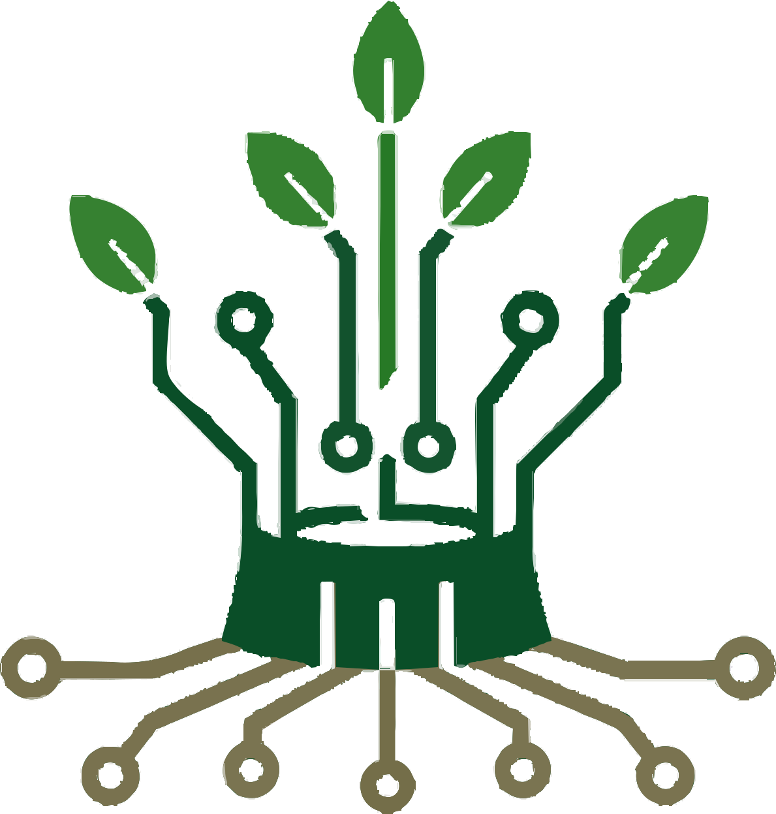
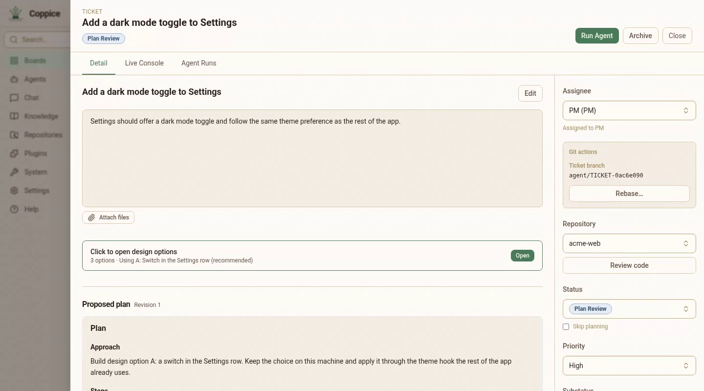
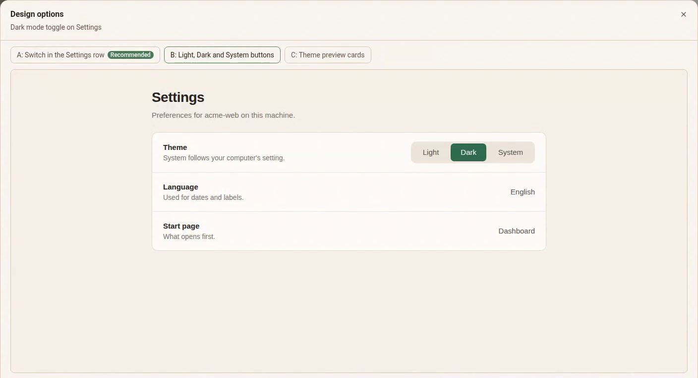
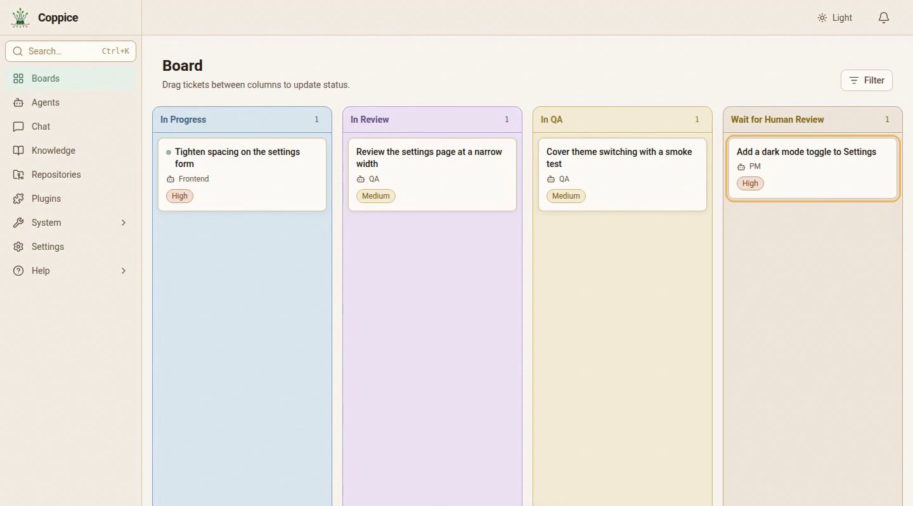
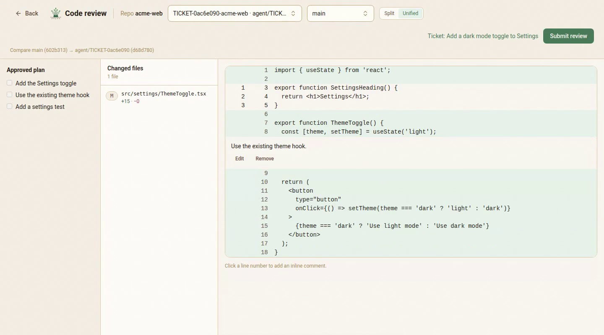

  <a href="README.md">English</a> ·
  <a href="README.vi.md">Tiếng Việt</a> ·
  <a href="README.zh-CN.md">简体中文</a> ·
  <a href="README.zh-TW.md">繁體中文（台灣）</a> ·
  <a href="README.zh-HK.md">繁體中文（香港）</a> ·
  <a href="README.ja.md">日本語</a> ·
  <a href="README.fr.md">Français</a>

  

<h1 align="center">Coppice</h1>

  <strong>Thuê chuyên gia. Bạn là người quyết định cuối cùng.</strong> 
  Ứng dụng desktop cho multi-agent coding. Các agent lên kế hoạch, viết code và review trên một bảng. Chỉ khi bạn chấp nhận diff thì việc mới tính là xong. 
  Chạy ngay trên máy bạn, mã nguồn mở, dùng các agent CLI bạn đang trả phí.

  <a href="https://github.com/fertile-org/coppice/releases/latest/download/Coppice-mac-arm64.dmg"><strong>Tải cho macOS (Apple Silicon)</strong></a> ·
  <a href="https://github.com/fertile-org/coppice/releases/latest/download/Coppice-linux-amd64.deb"><strong>Tải cho Linux (.deb)</strong></a> ·
  <a href="https://getcoppice.app/vi/download">Bản tải khác</a> ·
  <a href="https://getcoppice.app/vi/docs">Tài liệu</a>

  
  
  

  

Agent PM soạn kế hoạch, bạn duyệt. Các agent chuyên môn làm song song, mỗi agent một branch riêng. Nhìn vào bảng là biết việc nào đang chạy, việc nào bị kẹt và việc nào đang chờ bạn.

Tải về, mở lên là dùng. Không phải cài thêm gì: không Docker, không tài khoản Coppice.

## Vì sao chọn Coppice

- **Mỗi vai trò một model phù hợp.** Mỗi agent tự chọn CLI và model riêng. Lên kế hoạch và review bằng model mạnh nhất, viết code bằng model nhanh hơn, tất cả trên cùng một bảng.
- **Không phải chuyển qua lại giữa các terminal.** Việc của mỗi agent là một thẻ trên cùng một bảng. Ticket bị kẹt và việc đang chờ bạn review hiện rõ, nên bạn biết ngay chỗ nào cần bạn.
- **Phát hiện lỗi trước khi lỗi đó lọt vào code.** Mọi thay đổi đều nằm chờ bạn dưới dạng diff trong ứng dụng. Bạn chưa chấp nhận thì chưa xong, và thứ bạn chấp nhận chính là thứ được merge.
- **Không phải mua thêm gói nào.** Coppice dùng luôn các CLI bạn đang trả phí, đăng nhập như bạn vẫn làm. Xem các [CLI được hỗ trợ](https://getcoppice.app/vi/docs/providers).

## Cách hoạt động

### Lên kế hoạch với agent PM

Agent PM đọc ticket và soạn kế hoạch: cách làm, các bước, và cách kiểm tra thay đổi. Bạn duyệt kế hoạch trước khi có code được viết.

### Duyệt thiết kế

Khi ticket đổi phần người dùng nhìn thấy, agent đưa ra vài bố cục và đánh dấu phương án nó đề xuất. Bạn chọn một, và kế hoạch đi theo lựa chọn đó.

### Để các agent làm việc

Các agent chuyên môn viết code, review và test ticket. Mỗi ticket có git worktree riêng, nên việc làm song song không đụng bản checkout chính.

### Xem các thay đổi trong code

Đọc diff ngay trong ứng dụng và góp ý ở bất kỳ dòng nào. Chỉ khi bạn chấp nhận thì việc mới tính là xong, và Accept với Merge là hai lựa chọn riêng.

## Còn gì nữa

- **Chat với agent.** Bàn về code, một ý tưởng hay một ticket. Agent có thể soạn sẵn ticket hoặc gợi ý một ghi chú Knowledge, nhưng phải đợi bạn duyệt mới được lưu.
- **Mọi thứ đều nằm trên thẻ.** Bình luận, kế hoạch và các lần chạy agent đều lưu trên ticket. Các agent chỉ nói chuyện với nhau qua bình luận của ticket, nên chuyện gì xảy ra, bạn cũng đọc được ở đó.
- **Knowledge.** Agent ghi chú lại những điều về dự án để dùng cho các ticket sau. Mặc định, ghi chú nào được giữ là do bạn duyệt.
- **Plugin.** Bổ sung skill và công cụ MCP cho agent. Cài plugin từ git hoặc từ một thư mục, rồi chọn agent nào được dùng.
- **Tự động cập nhật.** Bản Linux cập nhật qua apt, còn bản macOS tự cập nhật.

## Coppice không phải là

- Dịch vụ viết code trên đám mây
- Công cụ thay thế Jira
- Kiểu “nói với agent một câu là có ngay sản phẩm”

## Bắt đầu

1. [Tải Coppice](https://getcoppice.app/vi/download): `.dmg` cho macOS (Apple Silicon hoặc Intel), `.deb` cho Linux (`amd64` hoặc `arm64`), hoặc Windows 11 qua WSL.
2. Làm theo [các bước cài đặt](https://getcoppice.app/vi/docs/install).
3. Đọc trang [Bắt đầu](https://getcoppice.app/vi/docs/getting-started) để tạo agent và ticket đầu tiên.

**Beta.** Coppice đang ở bản beta. Gặp lỗi hoặc thấy chỗ nào chưa ổn, [mở issue](https://github.com/fertile-org/coppice/issues) cho chúng tôi biết.

## Người đóng góp

Người đóng góp và CI chạy toàn bộ stack bằng Docker Compose. Bắt đầu với [AGENTS.md](AGENTS.md) và [docs/development.md](docs/development.md). Lộ trình nằm ở [docs/milestones/README.md](docs/milestones/README.md). Tài liệu sản phẩm là website trong [`website/`](website/).

## Giấy phép

Coppice là phần mềm mã nguồn mở theo [giấy phép Apache 2.0](LICENSE).
