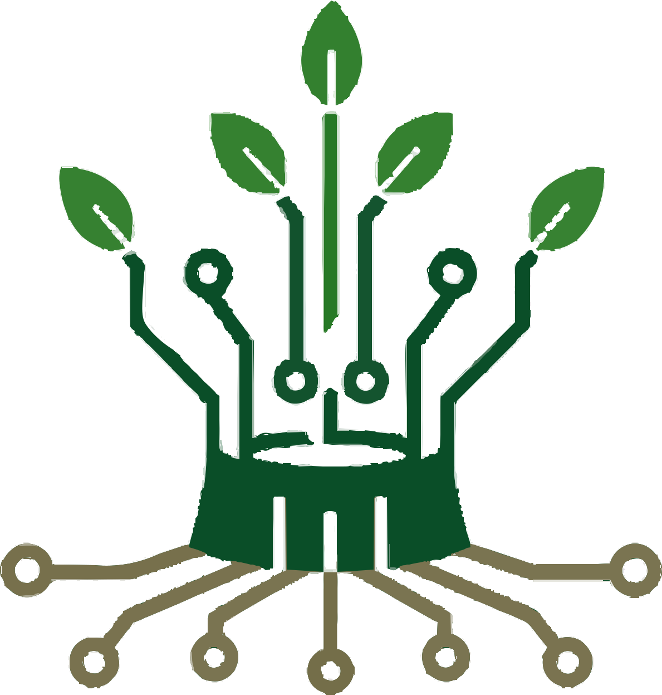
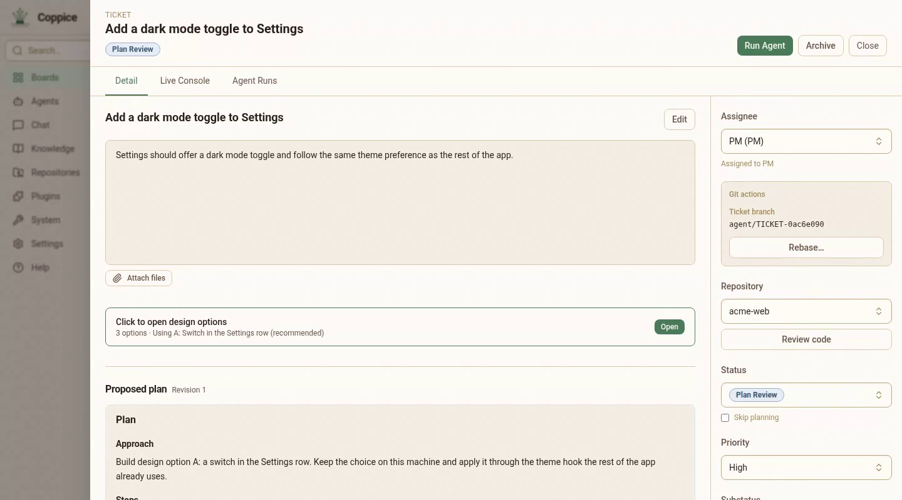
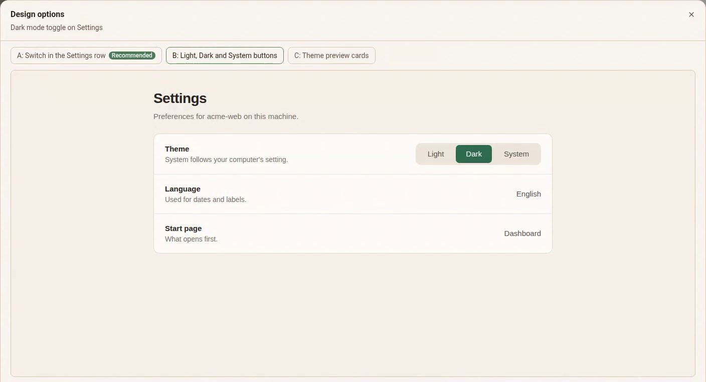
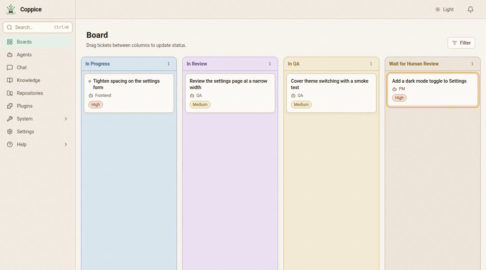
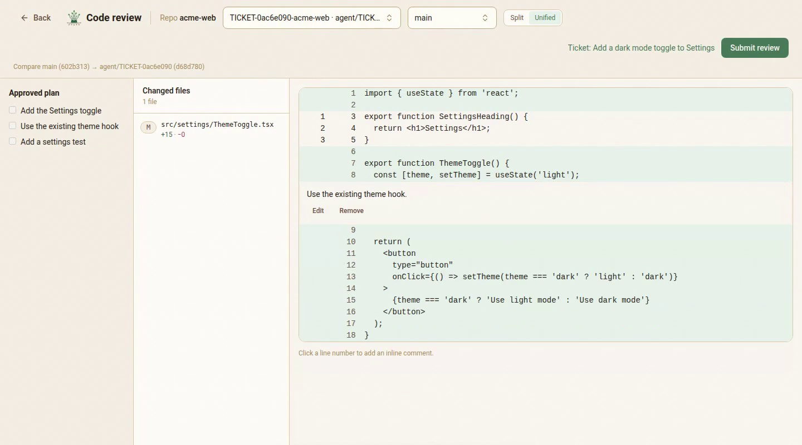

  <a href="README.md">English</a> ·
  <a href="README.vi.md">Tiếng Việt</a> ·
  <a href="README.zh-CN.md">简体中文</a> ·
  <a href="README.zh-TW.md">繁體中文（台灣）</a> ·
  <a href="README.zh-HK.md">繁體中文（香港）</a> ·
  <a href="README.ja.md">日本語</a> ·
  <a href="README.fr.md">Français</a>

  

<h1 align="center">Coppice</h1>

  <strong>雇用专家，你来拍板。</strong> 
  用于多智能体编程的桌面应用。智能体在同一块看板上规划、构建和审查。你一直在场。 
  本地运行，开源，用的是你已经付费的智能体 CLI。

  <a href="https://github.com/fertile-org/coppice/releases/latest/download/Coppice-mac-arm64.dmg"><strong>下载 macOS 版（Apple Silicon）</strong></a> ·
  <a href="https://github.com/fertile-org/coppice/releases/latest/download/Coppice-linux-amd64.deb"><strong>下载 Linux 版（.deb）</strong></a> ·
  <a href="https://getcoppice.app/zh-cn/download">其他下载</a> ·
  <a href="https://getcoppice.app/zh-cn/docs">文档</a>

  
  
  

  

你的 PM 智能体起草计划，由你批准。专业智能体并行构建，各自在自己的分支上。看板显示哪些在推进、哪些卡住了、哪些在等你。

下载、打开、开始工作。无需任何配置：不用 Docker，也不用 Coppice 账号。

## 为什么选择 Coppice

- **每个角色都用合适的模型。** 每个智能体各自选择 CLI 和模型。用最强的模型做规划和审查，用更快的模型写代码，全都在同一块看板上。
- **不用再在终端之间来回切换。** 每个智能体的工作都是同一块看板上的一张卡片。受阻的工单和等你审核的工作一目了然，你知道哪里需要你。
- **在落地之前发现错误。** 每个改动都会以 diff 的形式在应用里等你审核。你接受之前，什么都不算完成；你接受的内容，就是最终合并的内容。
- **不用再多一份订阅。** Coppice 驱动的是你已经付费的 CLI，登录方式和你平时一样。支持的 CLI 见 [提供商](https://getcoppice.app/zh-cn/docs/providers)。

## 工作方式

### 和 PM 智能体一起规划

PM 智能体阅读工单并起草计划：做法、步骤，以及如何检查这次改动。开始写代码之前，你先批准这份计划。

### 批准设计

当工单会改变人们看到的界面时，智能体会给出几个布局，并标出它推荐的一个。你选定一个，计划就按这个选择来写。

### 让智能体去构建

专业智能体负责构建、审查和测试。每个工单都有自己的 git worktree，并行的工作不会碰到你的主检出目录。

### 审查代码改动

在应用里阅读 diff，可以评论任意一行。你接受之前，什么都不算完成，接受和合并是两件分开的事。

## 还有这些

- **和你的智能体聊天。** 聊聊你的代码、一个想法或一个工单。智能体可以起草工单，或建议一条 Knowledge 笔记，但你批准之前，什么都不会保存。
- **一切都在卡片上。** 评论、计划和智能体运行都留在工单上。智能体之间只通过工单评论交流，所以事情如果发生过，你就能在工单上读到。
- **Knowledge。** 智能体会为以后的工单记下关于你项目的笔记。默认由你批准智能体保留哪些笔记。
- **插件。** 给智能体技能和 MCP 工具。从 git 或文件夹安装插件，再选择哪些智能体可以使用。
- **自动更新。** Linux 版通过 apt 更新，macOS 版由应用自己更新。

## 它不是什么

- 不是云端编程服务
- 不是 Jira 的替代品
- 不是“告诉智能体一句，就拿到成品”

## 开始使用

1. [下载 Coppice](https://getcoppice.app/zh-cn/download)：macOS 用 `.dmg`（Apple Silicon 或 Intel），Linux 用 `.deb`（`amd64` 或 `arm64`），或者通过 WSL 在 Windows 11 上运行。
2. 按照 [安装步骤](https://getcoppice.app/zh-cn/docs/install) 操作。
3. 阅读 [入门](https://getcoppice.app/zh-cn/docs/getting-started)，设置你的第一个智能体和工单。

**Beta。** Coppice 还在测试阶段。遇到出错或不对劲的地方，请 [提交 issue](https://github.com/fertile-org/coppice/issues)。

## 贡献者

贡献者和 CI 使用 Docker Compose 运行整套服务。先读 [AGENTS.md](AGENTS.md) 和 [docs/development.md](docs/development.md)。路线图在 [docs/milestones/README.md](docs/milestones/README.md)。产品文档是 [`website/`](website/) 里的网站。

## 许可证

Coppice 以 [Apache 2.0 许可证](LICENSE) 开源。
