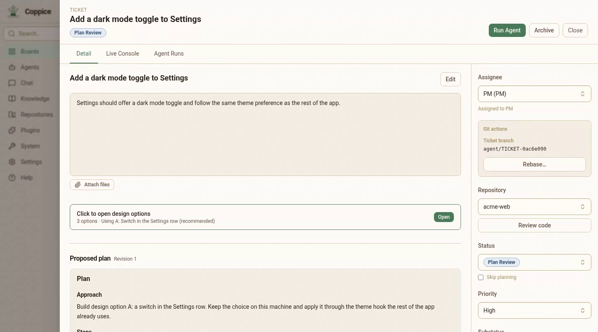
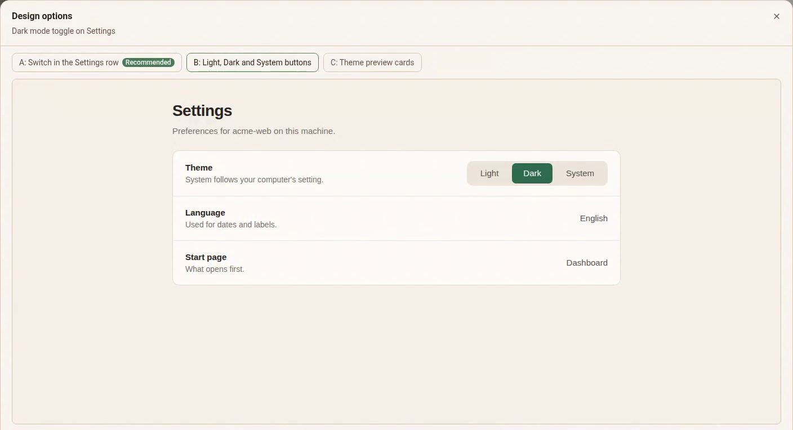
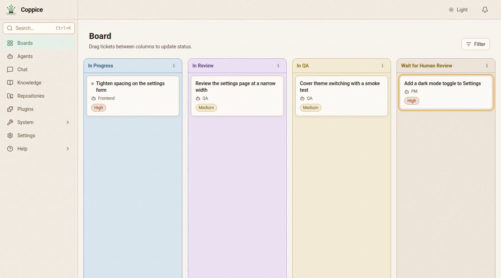
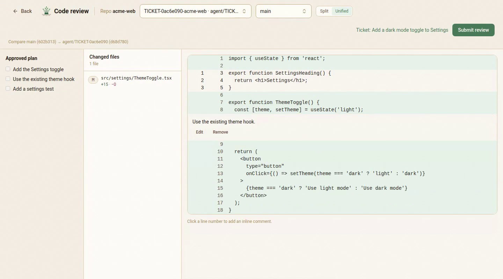

  <a href="README.md">English</a> ·
  <a href="README.vi.md">Tiếng Việt</a> ·
  <a href="README.zh-CN.md">简体中文</a> ·
  <a href="README.zh-TW.md">繁體中文（台灣）</a> ·
  <a href="README.zh-HK.md">繁體中文（香港）</a> ·
  <a href="README.ja.md">日本語</a> ·
  <a href="README.fr.md">Français</a>

  

<h1 align="center">Coppice</h1>

  <strong>僱用專家，你來拍板。</strong> 
  多代理程式設計的桌面軟件。代理在同一塊看板上規劃、構建和審查。全程由你把關。 
  本地執行，開源，用的是你已經付費的代理 CLI。

  <a href="https://github.com/fertile-org/coppice/releases/latest/download/Coppice-mac-arm64.dmg"><strong>下載 macOS 版（Apple Silicon）</strong></a> ·
  <a href="https://github.com/fertile-org/coppice/releases/latest/download/Coppice-linux-amd64.deb"><strong>下載 Linux 版（.deb）</strong></a> ·
  <a href="https://getcoppice.app/zh-hk/download">其他下載</a> ·
  <a href="https://getcoppice.app/zh-hk/docs">文件</a>

  
  
  

  

你的 PM 代理起草計劃，由你批准。專業代理並行構建，每個都在自己的分支上。看板顯示哪些在推進、哪些卡住了、哪些在等你。

下載、開啟、開工。不用另外設定：不用 Docker，也不用 Coppice 帳號。

## 為甚麼選擇 Coppice

- **每個角色都用合適的模型。** 每個代理各自選擇 CLI 和模型。用最強的模型做規劃和審查，用更快的模型寫程式碼，全都在同一塊看板上。
- **不用再在終端之間來回切換。** 每個代理的工作都是同一塊看板上的一張卡片。受阻的工單和等你審查的工作一目瞭然，你知道哪裏需要你。
- **在落地之前發現錯誤。** 每個改動都會以 diff 的形式在應用裏等你審查。你接受之前，甚麼都不算完成；你接受的內容，就是最終合併的內容。
- **不用再多一份訂閱。** Coppice 驅動的是你已經付費的 CLI，登入方式和你平時一樣。支援的 CLI 見 [供應商](https://getcoppice.app/zh-hk/docs/providers)。

## 工作方式

### 和 PM 代理一起規劃

PM 代理閱讀工單並起草計劃：做法、步驟，以及如何檢查這次改動。開始寫程式碼之前，你先批准這份計劃。

### 批准設計

當工單會改變人們看到的介面時，代理會給出幾個版面，並標出它推薦的一個。你選定一個，計劃就照這個選擇來寫。

### 讓代理去構建

專業代理負責構建、審查和測試。每個工單都有自己的 git worktree，並行的工作不會碰到你的主檢出目錄。

### 審查程式碼改動

在應用裏閱讀 diff，可以評論任意一行。你接受之前，甚麼都不算完成，接受和合併是兩件分開的事。

## 還有這些

- **和你的代理聊天。** 聊聊你的程式碼、一個想法或一個工單。代理可以起草工單或建議一條 Knowledge 筆記，但你批准之前甚麼都不會儲存。
- **一切都在卡片上。** 評論、計劃和代理執行都留在工單上。代理之間只透過工單評論交流，所以發生過的事，你都能在那裏讀到。
- **Knowledge。** 代理會為以後的工單記下關於你專案的筆記。預設由你批准它們保留甚麼。
- **外掛。** 給代理技能和 MCP 工具。從 git 或資料夾安裝外掛，再選擇哪些代理可以使用。
- **自動更新。** Linux 版透過 apt 更新，macOS 版由應用自己更新。

## 它不是甚麼

- 不是雲端程式設計服務
- 不是 Jira 的替代品
- 不是「告訴代理一句，就拿到成品」

## 開始使用

1. [下載 Coppice](https://getcoppice.app/zh-hk/download)：macOS 用 `.dmg`（Apple Silicon 或 Intel），Linux 用 `.deb`（`amd64` 或 `arm64`），或者透過 WSL 在 Windows 11 上執行。
2. 按照 [安裝步驟](https://getcoppice.app/zh-hk/docs/install) 操作。
3. 閱讀 [入門](https://getcoppice.app/zh-hk/docs/getting-started)，設定你的第一個代理和工單。

**Beta。** Coppice 還在測試階段。遇到出錯或不對勁的地方，請 [提交 issue](https://github.com/fertile-org/coppice/issues)。

## 貢獻者

貢獻者和 CI 使用 Docker Compose 執行整套服務。先讀 [AGENTS.md](AGENTS.md) 和 [docs/development.md](docs/development.md)。路線圖在 [docs/milestones/README.md](docs/milestones/README.md)。產品文件是 [`website/`](website/) 裏的網站。

## 授權

Coppice 以 [Apache 2.0 授權](LICENSE) 開源。
