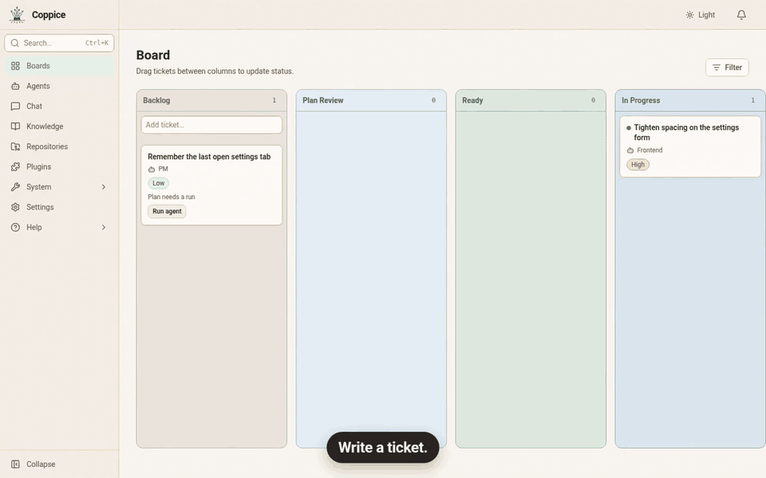
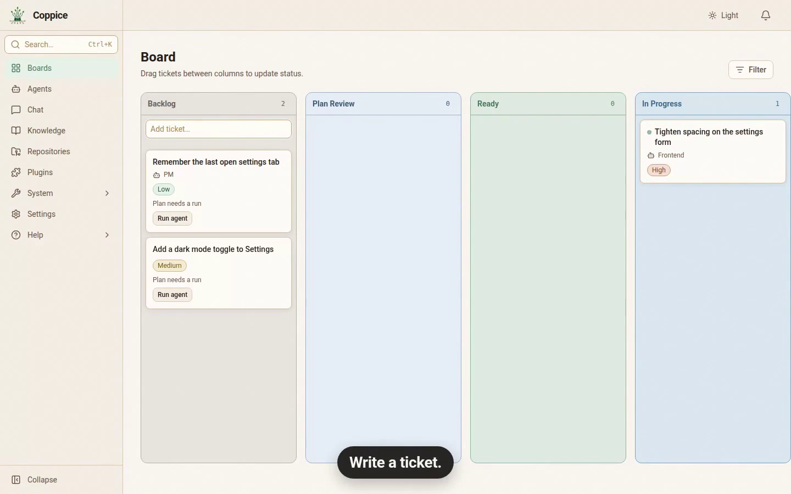
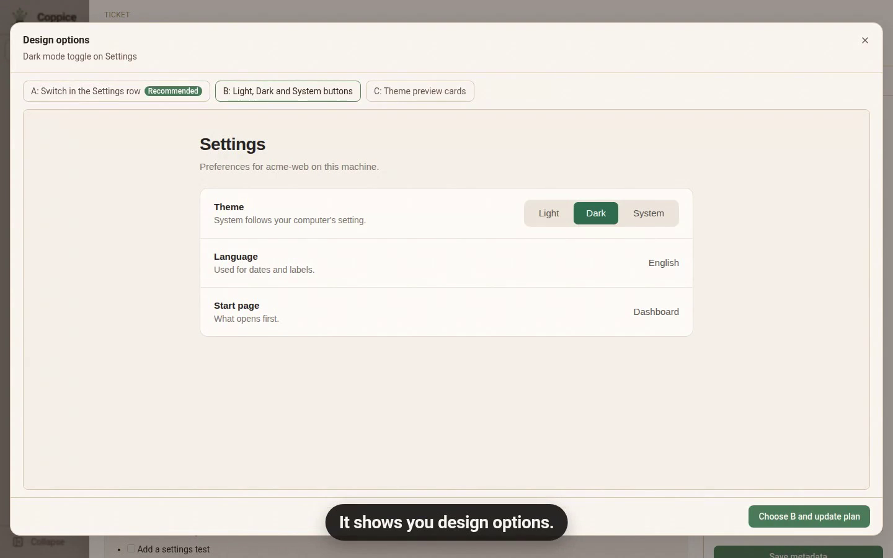
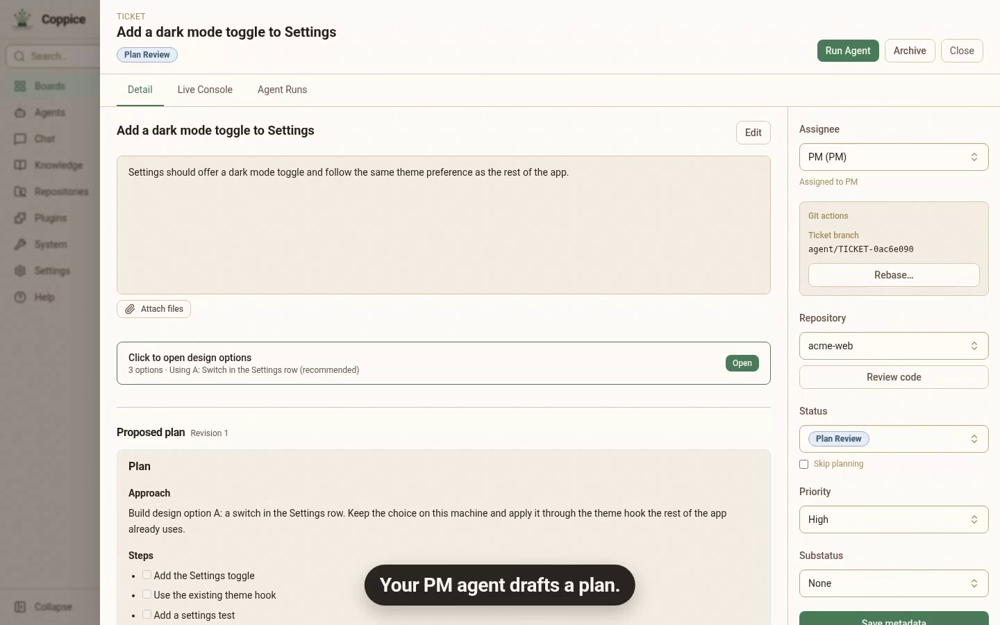
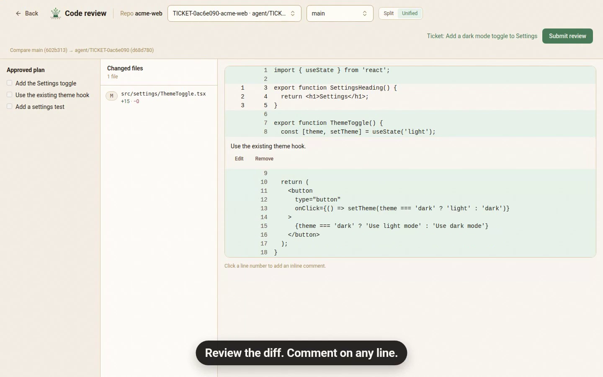

  <a href="README.md">English</a> ·
  <a href="README.vi.md">Tiếng Việt</a> ·
  <a href="README.zh-CN.md">简体中文</a> ·
  <a href="README.zh-TW.md">繁體中文（台灣）</a> ·
  <a href="README.zh-HK.md">繁體中文（香港）</a> ·
  <a href="README.ja.md">日本語</a> ·
  <a href="README.fr.md">Français</a>

  

<h1 align="center">Coppice</h1>

  <strong>僱用專家，你來拍板。</strong> 
  各自有角色的程式代理在同一塊看板上規劃、實作和審查。你接受 diff 之前，都不算完成。 
  在本機執行，開源，用的是你已經付費的代理 CLI。

  <a href="https://github.com/fertile-org/coppice/releases/latest/download/Coppice-mac-arm64.dmg"><strong>下載 macOS 版（Apple Silicon）</strong></a> ·
  <a href="https://github.com/fertile-org/coppice/releases/latest/download/Coppice-linux-amd64.deb"><strong>下載 Linux 版（.deb）</strong></a> ·
  <a href="https://getcoppice.app/zh-tw/download">其他下載</a> ·
  <a href="https://getcoppice.app/zh-tw/docs">文件</a>

  
  
  

  

你的 PM 代理起草計劃，由你批准。專業代理並行實作，各自使用自己的分支。看板會顯示哪些在進行、哪些卡住了、哪些在等你。你接受 diff 之前，都不算完成。

下載、開啟、開始做。不用另外設定：沒有 Docker，也沒有 Coppice 帳號。

## 為什麼選擇 Coppice

- **每個角色都用合適的模型。** 每個代理各自選擇 CLI 和模型。規劃和審查用你最強的模型，寫程式用較快的模型，都在同一塊看板上。
- **不用再在終端之間來回切換。** 每個代理的工作都是同一塊看板上的一張卡片。受阻的工單，以及等你審查的工作，都會明顯標出來，你就知道該看哪裡。
- **在合併之前找出錯誤。** 每個改動都會以 diff 的形式在應用裡等你審查。你接受之前，都不算完成；你接受的內容，就是最終合併的內容。
- **不用再多一份訂閱。** Coppice 驅動的是你已經付費的 CLI，登入方式和你平時一樣。

## 工作方式

1. **把工作交出去。** 寫一個工單，或批准代理建議的工單。把它指派給 PM 代理。PM 代理會起草計劃，介面改動則會附上設計方案；你批准之後，才會有人寫程式碼。開啟 **Skip planning**（跳過規劃），工單會直接進入 Ready。
2. **讓代理去實作。** 每個工單都有自己的 git worktree，並行的代理不會碰到你的主檢出目錄。每一次執行都可以即時查看。
3. **人工審查。** 在應用裡閱讀 diff，可以評論任意一行。你接受之前，都不算完成。

<table>
  <tr>
    <td width="25%"></td>
    <td width="25%"></td>
    <td width="25%"></td>
    <td width="25%"></td>
  </tr>
  <tr>
    <td align="center">所有代理，一塊看板</td>
    <td align="center">比較設計方案</td>
    <td align="center">先批准計劃</td>
    <td align="center">逐行審查 diff</td>
  </tr>
</table>

## 用你已經在用的 CLI

依平常的方式安裝並登入。Coppice 會在你登入 shell 的 `PATH` 裡找到它們。

| CLI | 命令 |
| --- | --- |
| Claude Code | `claude` |
| Codex | `codex` |
| Cursor | `cursor-agent` |
| OpenCode | `opencode` |
| Kilo Code | `kilo` |
| GitHub Copilot | `copilot` |
| Qwen Code | `qwen` |
| Kimi Code | `kimi` |
| Grok | `grok` |

安裝連結，以及各 CLI 支援的功能，見 [提供商](https://getcoppice.app/zh-tw/docs/providers)。

## 還有這些

- **和你的代理聊天。** 可以談程式碼、一個想法，或一張工單。代理可以起草工單，或建議一條 Knowledge 筆記，但你批准之前，什麼都不會儲存。
- **一切都在卡片上。** 評論、計劃和代理執行都留在工單上。代理之間只透過工單評論交流，所以發生過的事，你都能在那裡讀到。
- **Knowledge。** 代理會為以後的工單記下關於你專案的筆記。預設由你批准它們保留什麼。
- **外掛。** 給代理技能和 MCP 工具。從 git 或資料夾安裝外掛，再選擇哪些代理可以使用。
- **自動更新。** Linux 版透過 apt 更新，macOS 版由應用自己更新。

## 它不是什麼

- 不是雲端程式設計服務
- 不是 Jira 的替代品
- 不是「告訴代理一句，就拿到成品」

## 開始使用

1. [下載 Coppice](https://getcoppice.app/zh-tw/download)：macOS 用 `.dmg`（Apple Silicon 或 Intel），Linux 用 `.deb`（`amd64` 或 `arm64`），或者透過 WSL 在 Windows 11 上執行。
2. 依照 [安裝步驟](https://getcoppice.app/zh-tw/docs/install) 操作。
3. 閱讀 [入門](https://getcoppice.app/zh-tw/docs/getting-started)，設定第一個代理和工單。

**Beta。** Coppice 還在測試階段。如果出錯，或哪裡不對勁，請 [提交 issue](https://github.com/fertile-org/coppice/issues)。

## 貢獻者

貢獻者和 CI 用 Docker Compose 執行整套服務。先讀 [AGENTS.md](AGENTS.md) 和 [docs/development.md](docs/development.md)。路線圖在 [docs/milestones/README.md](docs/milestones/README.md)。產品文件是 [`website/`](website/) 裡的網站。

## 授權

Coppice 以 [Apache 2.0 授權](LICENSE) 開源。
